# Dokumentasi ERD, Desain Database & Seeder (SI-PKBK)

---

## 1. Entity-Relationship Diagram (ERD)

Diagram berikut memvisualisasikan relasi antar entitas utama dalam basis data **SI-PKBK**:

```mermaid
erDiagram
    USERS ||--o| WALI : "memiliki profil (1:1)"
    USERS ||--o{ PASSKEYS : "memiliki passkey (1:N)"
    USERS ||--o{ ASESMEN : "melakukan asesmen sebagai pekerja_sosial (1:N)"
    USERS ||--o{ JADWAL : "mengampu jadwal sebagai instruktur (1:N)"
    USERS ||--o{ PERTEMUAN_PEMBELAJARAN : "mencatat pertemuan sebagai instruktur (1:N)"
    USERS ||--o{ PERTEMUAN_PEMBELAJARAN : "memverifikasi pertemuan sebagai pekerja_sosial (1:N)"
    USERS ||--o{ GALERI : "mengunggah galeri sebagai admin (1:N)"

    ROLES ||--o{ MODEL_HAS_ROLES : "diberikan ke user"
    USERS ||--o{ MODEL_HAS_ROLES : "memiliki role"
    PERMISSIONS ||--o{ ROLE_HAS_PERMISSIONS : "dimiliki role"
    ROLES ||--o{ ROLE_HAS_PERMISSIONS : "memiliki permission"

    WALI ||--o{ ANGGOTA_KELUARGA : "memiliki susunan keluarga (1:N)"
    WALI ||--o{ PENDAFTARAN_PESERTA : "mendaftarkan peserta/klien (1:N)"

    JENIS_DISABILITAS ||--o{ PENDAFTARAN_PESERTA : "mengklasifikasikan peserta (1:N)"
    PENDAFTARAN_PESERTA ||--o{ PENDAFTARAN_PESERTA_BERKAS : "melampirkan berkas (1:N)"
    JENIS_BERKAS_PENDAFTARAN ||--o{ PENDAFTARAN_PESERTA_BERKAS : "menentukan jenis dokumen (1:N)"

    PENDAFTARAN_PESERTA ||--o| ASESMEN : "memiliki hasil asesmen (1:1)"
    ASESMEN ||--o{ ASESMEN_JAWABAN : "memiliki detail jawaban (1:N)"
    ASESMEN_SEKSI ||--o{ ASESMEN_PERTANYAAN : "mengelompokkan pertanyaan (1:N)"
    ASESMEN_PERTANYAAN ||--o{ ASESMEN_JAWABAN : "dijawab pada asesmen (1:N)"

    MATA_PELAJARAN ||--o{ JENIS_DISABILITAS_MATA_PELAJARAN : "terhubung ke disabilitas"
    JENIS_DISABILITAS ||--o{ JENIS_DISABILITAS_MATA_PELAJARAN : "memiliki kurikulum mapel"

    MATA_PELAJARAN ||--o{ JADWAL : "dijadwalkan pada kelas (1:N)"
    JADWAL ||--o{ PERTEMUAN_PEMBELAJARAN : "memiliki sesi pertemuan (1:N)"
    PERTEMUAN_PEMBELAJARAN ||--o{ PERTEMUAN_PEMBELAJARAN_PESERTA : "mencatat presensi & nilai peserta (1:N)"
    PENDAFTARAN_PESERTA ||--o{ PERTEMUAN_PEMBELAJARAN_PESERTA : "mengikuti pertemuan kelas (1:N)"

    PERTEMUAN_PEMBELAJARAN ||--o{ GALERI : "didokumentasikan dalam galeri (1:N)"
    GALERI ||--o{ GALERI_FOTO : "memuat banyak foto (1:N)"

    USERS {
        bigint id PK
        string name
        string email UK
        timestamp email_verified_at
        string password
        text two_factor_secret
        text two_factor_recovery_codes
        timestamp two_factor_confirmed_at
    }

    WALI {
        bigint id PK
        bigint user_id FK
        string nik UK
        text alamat
        string tempat_lahir
        date tanggal_lahir
        string agama
        string pendidikan_terakhir
        string status_dalam_keluarga
        string pekerjaan
        decimal penghasilan_perbulan
        int tanggungan_keluarga
        string rumah_tempat_tinggal
        text keadaan_lingkungan
        string nomor_hp
    }

    ANGGOTA_KELUARGA {
        bigint id PK
        bigint wali_id FK
        string nama
        string status
        date tanggal_lahir
        string pendidikan
        string pekerjaan
    }

    PENDAFTARAN_PESERTA {
        bigint id PK
        bigint wali_id FK
        bigint jenis_disabilitas_id FK
        string nik
        string no_pendaftaran UK
        string nama
        string jenis_kelamin
        string agama
        date tanggal_lahir
        decimal tinggi_badan
        decimal berat_badan
        enum status_pendaftaran
        datetime jadwal_asesmen
        string tempat_asesmen
        datetime tanggal_mulai_diterima
    }

    PENDAFTARAN_PESERTA_BERKAS {
        bigint id PK
        bigint pendaftaran_peserta_id FK
        bigint jenis_berkas_pendaftaran_id FK
        string file_path
        enum status
        text keterangan_perbaikan
    }

    ASESMEN {
        bigint id PK
        bigint pendaftaran_peserta_id FK
        bigint pekerja_sosial_id FK
        enum status
        date tanggal_asesmen
        json hal_hal_menyolok
        text kesimpulan_bentuk_bantuan
    }

    ASESMEN_SEKSI {
        bigint id PK
        string kode UK
        string nama
        int urutan
    }

    ASESMEN_PERTANYAAN {
        bigint id PK
        bigint asesmen_seksi_id FK
        int nomor
        text pertanyaan
        enum tipe_jawaban
        string satuan
        int urutan
    }

    ASESMEN_JAWABAN {
        bigint id PK
        bigint asesmen_id FK
        bigint asesmen_pertanyaan_id FK
        boolean jawaban_ya_tidak
        text jawaban_text
        decimal jawaban_number
        text keterangan
    }

    JENIS_DISABILITAS {
        bigint id PK
        string nama
        text keterangan
    }

    MATA_PELAJARAN {
        bigint id PK
        string nama
        text keterangan
    }

    JADWAL {
        bigint id PK
        bigint mata_pelajaran_id FK
        bigint instruktur_id FK
        smallint tahun
        enum hari
        time jam_mulai
        time jam_selesai
        string ruangan
    }

    PERTEMUAN_PEMBELAJARAN {
        bigint id PK
        bigint jadwal_id FK
        bigint instruktur_id FK
        bigint pekerja_sosial_id FK
        date tanggal
        enum status
        text keterangan
        text catatan_pekerja_sosial
        datetime approved_at
    }

    PERTEMUAN_PEMBELAJARAN_PESERTA {
        bigint id PK
        bigint pertemuan_pembelajaran_id FK
        bigint pendaftaran_peserta_id FK
        enum presensi
        enum nilai
        text keterangan
    }

    GALERI {
        bigint id PK
        bigint pertemuan_pembelajaran_id FK
        bigint created_by FK
        string judul
        text keterangan
    }

    GALERI_FOTO {
        bigint id PK
        bigint galeri_id FK
        string file_path
        string nama_file
        string keterangan
    }
```

---

## 2. Katalog Seluruh Migrasi Database (28 File Migrasi)

Seluruh perubahan skema dikelola secara terurut melalui 28 file migrasi di direktori `database/migrations/`:

| No | Nama File Migrasi | Operasi | Tabel Target | Deskripsi Perubahan |
| :-: | :--- | :--- | :--- | :--- |
| 1 | [0001_01_01_000000_create_users_table.php](file:///c:/Users/DELL/Development/php/si-pkbk/database/migrations/0001_01_01_000000_create_users_table.php) | `CREATE` | `users`, `password_reset_tokens`, `sessions` | Membuat tabel akun pengguna utama, token reset password, dan sesi login. |
| 2 | [0001_01_01_000001_create_cache_table.php](file:///c:/Users/DELL/Development/php/si-pkbk/database/migrations/0001_01_01_000001_create_cache_table.php) | `CREATE` | `cache`, `cache_locks` | Membuat tabel penyimpanan cache aplikasi. |
| 3 | [0001_01_01_000002_create_jobs_table.php](file:///c:/Users/DELL/Development/php/si-pkbk/database/migrations/0001_01_01_000002_create_jobs_table.php) | `CREATE` | `jobs`, `job_batches`, `failed_jobs` | Membuat tabel antrean *background jobs*. |
| 4 | [2024_01_01_000000_create_passkeys_table.php](file:///c:/Users/DELL/Development/php/si-pkbk/database/migrations/2024_01_01_000000_create_passkeys_table.php) | `CREATE` | `passkeys` | Membuat tabel kredensial WebAuthn / Passkey milik pengguna. |
| 5 | [2025_08_14_170933_add_two_factor_columns_to_users_table.php](file:///c:/Users/DELL/Development/php/si-pkbk/database/migrations/2025_08_14_170933_add_two_factor_columns_to_users_table.php) | `ALTER` | `users` | Menambahkan kolom `two_factor_secret`, `two_factor_recovery_codes`, dan `two_factor_confirmed_at` untuk Laravel Fortify 2FA. |
| 6 | [2026_10_02_071225_create_permission_tables.php](file:///c:/Users/DELL/Development/php/si-pkbk/database/migrations/2026_10_02_071225_create_permission_tables.php) | `CREATE` | `permissions`, `roles`, `model_has_permissions`, `model_has_roles`, `role_has_permissions` | Membuat 5 tabel RBAC untuk paket `spatie/laravel-permission`. |
| 7 | [2026_10_03_213134_create_walis_table.php](file:///c:/Users/DELL/Development/php/si-pkbk/database/migrations/2026_10_03_213134_create_walis_table.php) | `CREATE` | `wali` | Membuat tabel profil orang tua / wali (`user_id`, `nik`, `alamat`, `tempat_lahir`, `tanggal_lahir`, `nomor_hp`). |
| 8 | [2026_10_04_011841_create_persyaratan_administrasis_table.php](file:///c:/Users/DELL/Development/php/si-pkbk/database/migrations/2026_10_04_011841_create_persyaratan_administrasis_table.php) | `CREATE` | `persyaratan_administrasi` | Membuat tabel master butir persyaratan administrasi pendaftaran. |
| 9 | [2026_10_04_070230_create_pendaftaran_pesertas_table.php](file:///c:/Users/DELL/Development/php/si-pkbk/database/migrations/2026_10_04_070230_create_pendaftaran_pesertas_table.php) | `CREATE` | `pendaftaran_peserta` | Membuat tabel transaksi pendaftaran calon peserta rehabilitasi. |
| 10 | [2026_10_04_074436_create_jenis_berkas_pendaftarans_table.php](file:///c:/Users/DELL/Development/php/si-pkbk/database/migrations/2026_10_04_074436_create_jenis_berkas_pendaftarans_table.php) | `CREATE` | `jenis_berkas_pendaftaran` | Membuat tabel master jenis dokumen persyaratan pendaftaran beserta *template* surat. |
| 11 | [2026_10_04_075542_create_pendaftaran_peserta_berkas_table.php](file:///c:/Users/DELL/Development/php/si-pkbk/database/migrations/2026_10_04_075542_create_pendaftaran_peserta_berkas_table.php) | `CREATE` | `pendaftaran_peserta_berkas` | Membuat tabel lampiran file berkas yang diunggah wali untuk setiap pendaftaran peserta. |
| 12 | [2026_10_04_160050_add_verifikasi_columns_to_pendaftaran_peserta_table.php](file:///c:/Users/DELL/Development/php/si-pkbk/database/migrations/2026_10_04_160050_add_verifikasi_columns_to_pendaftaran_peserta_table.php) | `ALTER` | `pendaftaran_peserta` | Menambahkan kolom `catatan_verifikasi`, `jadwal_asesmen`, dan `tempat_asesmen`. |
| 13 | [2026_10_04_171457_add_identifikasi_fields_to_pendaftaran_peserta_table.php](file:///c:/Users/DELL/Development/php/si-pkbk/database/migrations/2026_10_04_171457_add_identifikasi_fields_to_pendaftaran_peserta_table.php) | `ALTER` | `pendaftaran_peserta` | Menambahkan 15 kolom identifikasi fisik & riwayat disabilitas klien untuk instrumen asesmen. |
| 14 | [2026_10_04_171501_add_extra_fields_to_wali_table.php](file:///c:/Users/DELL/Development/php/si-pkbk/database/migrations/2026_10_04_171501_add_extra_fields_to_wali_table.php) | `ALTER` | `wali` | Menambahkan 8 kolom profil sosial-ekonomi keluarga (`agama`, `pendidikan_terakhir`, `pekerjaan`, `penghasilan_perbulan`, `tanggungan_keluarga`, dll.). |
| 15 | [2026_10_04_171506_create_anggota_keluarga_table.php](file:///c:/Users/DELL/Development/php/si-pkbk/database/migrations/2026_10_04_171506_create_anggota_keluarga_table.php) | `CREATE` | `anggota_keluarga` | Membuat tabel susunan anggota keluarga dari wali. |
| 16 | [2026_10_04_171507_create_asesmen_table.php](file:///c:/Users/DELL/Development/php/si-pkbk/database/migrations/2026_10_04_171507_create_asesmen_table.php) | `CREATE` | `asesmen` | Membuat tabel transaksi utama asesmen klien oleh Pekerja Sosial. |
| 17 | [2026_10_04_171508_create_asesmen_seksi_table.php](file:///c:/Users/DELL/Development/php/si-pkbk/database/migrations/2026_10_04_171508_create_asesmen_seksi_table.php) | `CREATE` | `asesmen_seksi` | Membuat tabel master kategori/seksi instrumen pertanyaan asesmen. |
| 18 | [2026_10_04_171509_create_asesmen_pertanyaan_table.php](file:///c:/Users/DELL/Development/php/si-pkbk/database/migrations/2026_10_04_171509_create_asesmen_pertanyaan_table.php) | `CREATE` | `asesmen_pertanyaan` | Membuat tabel master daftar butir pertanyaan per seksi asesmen. |
| 19 | [2026_10_04_171510_create_asesmen_jawaban_table.php](file:///c:/Users/DELL/Development/php/si-pkbk/database/migrations/2026_10_04_171510_create_asesmen_jawaban_table.php) | `CREATE` | `asesmen_jawaban` | Membuat tabel jawaban per butir pertanyaan pada asesmen klien. |
| 20 | [2026_10_04_172016_add_balita_fields_to_asesmen_table.php](file:///c:/Users/DELL/Development/php/si-pkbk/database/migrations/2026_10_04_172016_add_balita_fields_to_asesmen_table.php) | `ALTER` | `asesmen` | Menambahkan 15 kolom riwayat masalah kelahiran (bayi kuning, ASI, kejang, diare) dan perkembangan balita (`hal_hal_menyolok`). |
| 21 | [2026_10_04_172047_add_keterangan_to_asesmen_jawaban_table.php](file:///c:/Users/DELL/Development/php/si-pkbk/database/migrations/2026_10_04_172047_add_keterangan_to_asesmen_jawaban_table.php) | `ALTER` | `asesmen_jawaban` | Menambahkan kolom `keterangan` tambahan pada tiap jawaban asesmen. |
| 22 | [2026_10_21_150704_create_jenis_disabilitas_table.php](file:///c:/Users/DELL/Development/php/si-pkbk/database/migrations/2026_10_21_150704_create_jenis_disabilitas_table.php) | `CREATE` | `jenis_disabilitas` | Membuat tabel master kategori disabilitas (`Tuna Wicara`, `Tuna Rungu`, `Tuna Netra`). |
| 23 | [2026_10_21_150705_add_jenis_disabilitas_id_to_pendaftaran_peserta_table.php](file:///c:/Users/DELL/Development/php/si-pkbk/database/migrations/2026_10_21_150705_add_jenis_disabilitas_id_to_pendaftaran_peserta_table.php) | `ALTER` | `pendaftaran_peserta` | Menambahkan *foreign key* `jenis_disabilitas_id` pada tabel `pendaftaran_peserta`. |
| 24 | [2026_10_21_153835_create_mata_pelajarans_table.php](file:///c:/Users/DELL/Development/php/si-pkbk/database/migrations/2026_10_21_153835_create_mata_pelajarans_table.php) | `CREATE` | `mata_pelajaran`, `jenis_disabilitas_mata_pelajaran` | Membuat tabel master mata pelajaran dan tabel *pivot* relasi ke jenis disabilitas. |
| 25 | [2026_10_21_153836_create_jadwals_table.php](file:///c:/Users/DELL/Development/php/si-pkbk/database/migrations/2026_10_21_153836_create_jadwals_table.php) | `CREATE` | `jadwal` | Membuat tabel jadwal pembelajaran kelas per tahun, hari, jam, ruangan, mapel, dan instruktur. |
| 26 | [2026_10_21_161557_add_tanggal_mulai_diterima_to_pendaftaran_peserta_table.php](file:///c:/Users/DELL/Development/php/si-pkbk/database/migrations/2026_10_21_161557_add_tanggal_mulai_diterima_to_pendaftaran_peserta_table.php) | `ALTER` | `pendaftaran_peserta` | Menambahkan kolom `tanggal_mulai_diterima` saat peserta dinyatakan lulus oleh Kepala Seksi. |
| 27 | [2026_10_21_163321_create_pertemuan_pembelajarans_table.php](file:///c:/Users/DELL/Development/php/si-pkbk/database/migrations/2026_10_21_163321_create_pertemuan_pembelajarans_table.php) | `CREATE` | `pertemuan_pembelajaran`, `pertemuan_pembelajaran_peserta` | Membuat tabel sesi pertemuan pembelajaran dan detail presensi + penilaian kualitatif peserta. |
| 28 | [2026_10_24_065452_create_galeris_table.php](file:///c:/Users/DELL/Development/php/si-pkbk/database/migrations/2026_10_24_065452_create_galeris_table.php) | `CREATE` | `galeri`, `galeri_foto` | Membuat tabel album galeri yang terhubung ke `pertemuan_pembelajaran` beserta tabel multi-foto dokumentasi. |

---

## 3. Spesifikasi Detail Struktur Tabel Domain

### 3.1 Tabel `users`
Menyimpan kredensial seluruh pengguna sistem (Administrator, Pekerja Sosial, Instruktur, Kepala Seksi, dan Wali).

| Kolom | Tipe Data | Constraint / Indeks | Keterangan |
| :--- | :--- | :--- | :--- |
| `id` | `bigint unsigned` | `PK`, `AUTO_INCREMENT` | Primary key pengguna |
| `name` | `varchar(255)` | `NOT NULL` | Nama lengkap pengguna |
| `email` | `varchar(255)` | `UNIQUE`, `NOT NULL` | Alamat email untuk login |
| `email_verified_at` | `timestamp` | `NULLABLE` | Waktu verifikasi email |
| `password` | `varchar(255)` | `NOT NULL` | Hash kata sandi |
| `two_factor_secret` | `text` | `NULLABLE` | Secret TOTP 2FA |
| `two_factor_recovery_codes` | `text` | `NULLABLE` | Kode pemulihan 2FA |
| `two_factor_confirmed_at` | `timestamp` | `NULLABLE` | Waktu aktivasi 2FA |
| `remember_token` | `varchar(100)` | `NULLABLE` | Token sesi ingat saya |
| `created_at`, `updated_at` | `timestamp` | `NULLABLE` | Waktu pembuatan & pembaruan |

### 3.2 Tabel `wali`
Menyimpan data identitas dan kondisi sosial-ekonomi Orang Tua / Wali peserta.

| Kolom | Tipe Data | Constraint / Indeks | Keterangan |
| :--- | :--- | :--- | :--- |
| `id` | `bigint unsigned` | `PK`, `AUTO_INCREMENT` | Primary key wali |
| `user_id` | `bigint unsigned` | `FK -> users.id (CASCADE)` | Akun pengguna milik wali |
| `nik` | `varchar(255)` | `UNIQUE`, `NOT NULL` | Nomor Induk Kependudukan wali |
| `alamat` | `text` | `NOT NULL` | Alamat lengkap tempat tinggal |
| `tempat_lahir` | `varchar(255)` | `NOT NULL` | Kota/kabupaten kelahiran wali |
| `tanggal_lahir` | `date` | `NOT NULL` | Tanggal lahir wali |
| `agama` | `varchar(255)` | `NULLABLE` | Agama wali (diisi saat asesmen) |
| `pendidikan_terakhir` | `varchar(255)` | `NULLABLE` | Pendidikan terakhir wali |
| `status_dalam_keluarga` | `varchar(255)` | `NULLABLE` | Ayah / Ibu / Wali |
| `pekerjaan` | `varchar(255)` | `NULLABLE` | Pekerjaan utama wali |
| `penghasilan_perbulan` | `decimal(12,2)` | `NULLABLE` | Penghasilan bulanan (Rp) |
| `tanggungan_keluarga` | `int` | `NULLABLE` | Jumlah tanggungan dalam keluarga |
| `rumah_tempat_tinggal` | `varchar(255)` | `NULLABLE` | Status kepemilikan rumah |
| `keadaan_lingkungan` | `text` | `NULLABLE` | Deskripsi lingkungan tempat tinggal |
| `nomor_hp` | `varchar(255)` | `NOT NULL` | Nomor telepon/WhatsApp aktif |
| `created_at`, `updated_at` | `timestamp` | `NULLABLE` | Waktu pembuatan & pembaruan |

### 3.3 Tabel `anggota_keluarga`
Menyimpan daftar susunan anggota keluarga dari seorang Wali.

| Kolom | Tipe Data | Constraint / Indeks | Keterangan |
| :--- | :--- | :--- | :--- |
| `id` | `bigint unsigned` | `PK`, `AUTO_INCREMENT` | Primary key anggota keluarga |
| `wali_id` | `bigint unsigned` | `FK -> wali.id (CASCADE)` | Referensi ke tabel `wali` |
| `nama` | `varchar(255)` | `NOT NULL` | Nama lengkap anggota keluarga |
| `status` | `varchar(255)` | `NOT NULL` | Hubungan keluarga (anak, istri, suami, dll.) |
| `tanggal_lahir` | `date` | `NULLABLE` | Tanggal lahir anggota keluarga |
| `pendidikan` | `varchar(255)` | `NULLABLE` | Pendidikan anggota keluarga |
| `pekerjaan` | `varchar(255)` | `NULLABLE` | Pekerjaan anggota keluarga |
| `created_at`, `updated_at` | `timestamp` | `NULLABLE` | Waktu pembuatan & pembaruan |

### 3.4 Tabel `persyaratan_administrasi` & `jenis_berkas_pendaftaran`
Tabel master untuk persyaratan administrasi dan dokumen pendaftaran.

- **`persyaratan_administrasi`**:
  - `id` (`bigint PK`), `deskripsi` (`text NOT NULL`), `timestamps`.
- **`jenis_berkas_pendaftaran`**:
  - `id` (`bigint PK`), `nama_berkas` (`varchar(255) NOT NULL`), `required` (`boolean DEFAULT true`), `format_file` (`varchar(255)`), `template_surat` (`varchar(255) NULLABLE`), `timestamps`.

### 3.5 Tabel `jenis_disabilitas`
Menyimpan kategori disabilitas yang dilayani.

| Kolom | Tipe Data | Constraint / Indeks | Keterangan |
| :--- | :--- | :--- | :--- |
| `id` | `bigint unsigned` | `PK`, `AUTO_INCREMENT` | Primary key jenis disabilitas |
| `nama` | `varchar(255)` | `NOT NULL` | `Tuna Wicara`, `Tuna Rungu`, `Tuna Netra` |
| `keterangan` | `text` | `NULLABLE` | Deskripsi hambatan disabilitas |
| `created_at`, `updated_at` | `timestamp` | `NULLABLE` | Waktu pembuatan & pembaruan |

### 3.6 Tabel `pendaftaran_peserta`
Tabel inti yang menyimpan data calon peserta/klien rehabilitasi beserta seluruh atribut identifikasi klinis dan tahapan statusnya.

| Kolom | Tipe Data | Constraint / Indeks | Keterangan |
| :--- | :--- | :--- | :--- |
| `id` | `bigint unsigned` | `PK`, `AUTO_INCREMENT` | Primary key peserta |
| `wali_id` | `bigint unsigned` | `FK -> wali.id (CASCADE)` | Wali yang mendaftarkan peserta |
| `jenis_disabilitas_id` | `bigint unsigned` | `FK -> jenis_disabilitas.id (NULL ON DELETE)` | Klasifikasi disabilitas peserta |
| `nik` | `varchar(255)` | `NOT NULL` | NIK calon peserta |
| `no_pendaftaran` | `varchar(255)` | `UNIQUE`, `NOT NULL` | Nomor registrasi unik |
| `nama` | `varchar(255)` | `NOT NULL` | Nama lengkap peserta |
| `jenis_kelamin` | `varchar(255)` | `NULLABLE` | `Laki-laki` / `Perempuan` |
| `agama` | `varchar(255)` | `NULLABLE` | Agama peserta |
| `status_perkawinan` | `varchar(255)` | `NULLABLE` | Status perkawinan |
| `tinggi_badan` | `decimal(5,2)` | `NULLABLE` | Tinggi badan dalam `cm` |
| `berat_badan` | `decimal(5,2)` | `NULLABLE` | Berat badan dalam `kg` |
| `bentuk_keadaan_mata` | `varchar(255)` | `NULLABLE` | Kondisi fisik mata |
| `pendengaran` | `varchar(255)` | `NULLABLE` | Kondisi fungsi pendengaran |
| `golongan_darah` | `varchar(255)` | `NULLABLE` | Golongan darah (`A`, `B`, `AB`, `O`) |
| `nomor_induk_klien` | `varchar(255)` | `NULLABLE` | Nomor induk klien setelah registrasi |
| `disabilitas_netra_sejak` | `varchar(255)` | `NULLABLE` | Waktu mulai mengalami disabilitas |
| `penyebab_disabilitas` | `varchar(255)` | `NULLABLE` | Faktor penyebab disabilitas |
| `tempat_cacat` | `varchar(255)` | `NULLABLE` | Lokasi/bagian tubuh disabilitas |
| `pengaruh_cacat_tingkah_laku` | `text` | `NULLABLE` | Dampak disabilitas pada perilaku |
| `dirawat_di` | `varchar(255)` | `NULLABLE` | Riwayat perawatan medis/rehabilitasi |
| `gradasi_kecacatan` | `varchar(255)` | `NULLABLE` | Tingkat/gradasi kecacatan |
| `tempat_lahir` | `varchar(255)` | `NOT NULL` | Tempat lahir peserta |
| `tanggal_lahir` | `date` | `NOT NULL` | Tanggal lahir (usia 9–35 tahun) |
| `alamat_asal` | `text` | `NOT NULL` | Alamat asal peserta |
| `pendidikan` | `varchar(255)` | `NOT NULL` | Pendidikan terakhir |
| `keterampilan_yang_diminati` | `varchar(255)` | `NOT NULL` | Minat keterampilan vokasional |
| `status_pendaftaran` | `enum` | `DEFAULT 'draft'` | `draft`, `menunggu_verifikasi`, `perbaikan_berkas`, `asesmen`, `selesai_asesmen`, `diterima`, `ditolak` |
| `tanggal_mulai_diterima` | `datetime` | `NULLABLE`, `INDEX` | Tanggal resmi dinyatakan lulus/diterima |
| `catatan_verifikasi` | `text` | `NULLABLE` | Catatan verifikasi berkas dari Admin |
| `jadwal_asesmen` | `datetime` | `NULLABLE` | Waktu pelaksanaan asesmen |
| `tempat_asesmen` | `varchar(255)` | `NULLABLE` | Lokasi pelaksanaan asesmen |
| `created_at`, `updated_at` | `timestamp` | `NULLABLE` | Waktu pembuatan & pembaruan |

### 3.7 Tabel `pendaftaran_peserta_berkas`
Menyimpan berkas dokumen persyaratan yang diunggah untuk setiap peserta.

| Kolom | Tipe Data | Constraint / Indeks | Keterangan |
| :--- | :--- | :--- | :--- |
| `id` | `bigint unsigned` | `PK`, `AUTO_INCREMENT` | Primary key berkas peserta |
| `pendaftaran_peserta_id` | `bigint unsigned` | `FK -> pendaftaran_peserta.id (CASCADE)` | Peserta pemilik berkas |
| `jenis_berkas_pendaftaran_id` | `bigint unsigned` | `FK -> jenis_berkas_pendaftaran.id (CASCADE)` | Jenis dokumen persyaratan |
| `file_path` | `varchar(255)` | `NULLABLE` | Path penyimpanan file di disk `public` |
| `status` | `enum` | `DEFAULT 'menunggu_verifikasi'` | `menunggu_verifikasi`, `diterima`, `perbaikan` |
| `keterangan_perbaikan` | `text` | `NULLABLE` | Catatan revisi spesifik dokumen |
| `created_at`, `updated_at` | `timestamp` | `NULLABLE` | Waktu pembuatan & pembaruan |

### 3.8 Tabel Instrumen Asesmen (`asesmen`, `asesmen_seksi`, `asesmen_pertanyaan`, `asesmen_jawaban`)
1. **`asesmen`**:
   - `id` (`bigint PK`), `pendaftaran_peserta_id` (`FK -> pendaftaran_peserta.id CASCADE`), `pekerja_sosial_id` (`FK -> users.id NULL ON DELETE`), `status` (`enum: 'draft', 'selesai'`), `tanggal_asesmen` (`date`).
   - Kolom Pendidikan Formal & Non-Formal: `pendidikan_tk`, `pendidikan_sd`, `pendidikan_smp`, `pendidikan_sma`, `pendidikan_pt`, `kursus_nama`, `kursus_diberikan_oleh`, `kursus_tempat`, `kursus_lama`.
   - Kolom Sikap Emosional: `sikap_klien`, `sikap_keluarga`, `sikap_masyarakat`, `keluhan_hambatan`.
   - Kolom Masalah Kelahiran & Balita: `bayi_kuning`, `bayi_kuning_penanganan`, `bayi_kuning_uv_hari`, `bayi_hisap_asi`, `lama_asi_bulan`, `lama_asi_lainnya`, `masalah_kejang_stuip`, `masalah_kejang_stuip_ket`, `masalah_diare`, `masalah_diare_ket`, `masalah_lainnya`, `masalah_lainnya_ket`, `hal_hal_menyolok` (`json`), `catatan_tambahan_balita`, `pendapat_sekolah`.
   - Kolom Tujuan, Minat & Sumber Informasi (`boolean`): `tujuan_bimbingan_keterampilan`, `tujuan_bimbingan_sekolah`, `keterampilan_praktis_produktif`, `keterampilan_massage_pijat`, `info_dokter_rs`, `info_petugas_sosial_kec`, `info_dinas_sosial`, `info_psm`, `info_teman`.
   - Kolom Kesimpulan: `kesimpulan_latar_belakang`, `kesimpulan_pengaruh_kecacatan`, `kesimpulan_keinginan_harapan`, `kesimpulan_bentuk_bantuan`.
2. **`asesmen_seksi`**:
   - `id` (`bigint PK`), `kode` (`varchar UNIQUE`), `nama` (`varchar`), `urutan` (`int`).
3. **`asesmen_pertanyaan`**:
   - `id` (`bigint PK`), `asesmen_seksi_id` (`FK -> asesmen_seksi.id CASCADE`), `nomor` (`int`), `pertanyaan` (`text`), `tipe_jawaban` (`enum: 'ya_tidak', 'text', 'number'`), `satuan` (`varchar NULLABLE`), `urutan` (`int`).
4. **`asesmen_jawaban`**:
   - `id` (`bigint PK`), `asesmen_id` (`FK -> asesmen.id CASCADE`), `asesmen_pertanyaan_id` (`FK -> asesmen_pertanyaan.id CASCADE`), `jawaban_ya_tidak` (`boolean NULLABLE`), `jawaban_text` (`text NULLABLE`), `jawaban_number` (`decimal(8,2) NULLABLE`), `keterangan` (`text NULLABLE`).
   - Memiliki constraint unik komposit `UNIQUE(asesmen_id, asesmen_pertanyaan_id)`.

### 3.9 Tabel Kurikulum & Pembelajaran (`mata_pelajaran`, `jenis_disabilitas_mata_pelajaran`, `jadwal`, `pertemuan_pembelajaran`, `pertemuan_pembelajaran_peserta`)
1. **`mata_pelajaran`**:
   - `id` (`bigint PK`), `nama` (`varchar(255)`), `keterangan` (`text NULLABLE`), `timestamps`.
2. **`jenis_disabilitas_mata_pelajaran`** (Tabel Pivot):
   - `id` (`bigint PK`), `mata_pelajaran_id` (`FK -> mata_pelajaran.id CASCADE`), `jenis_disabilitas_id` (`FK -> jenis_disabilitas.id CASCADE`), `UNIQUE(mata_pelajaran_id, jenis_disabilitas_id)`.
3. **`jadwal`**:
   - `id` (`bigint PK`), `mata_pelajaran_id` (`FK -> mata_pelajaran.id CASCADE`), `instruktur_id` (`FK -> users.id CASCADE`), `tahun` (`smallint unsigned INDEX`), `hari` (`enum: 'Senin'..'Sabtu'`), `jam_mulai` (`time`), `jam_selesai` (`time`), `ruangan` (`varchar NULLABLE`), `keterangan` (`text NULLABLE`), `timestamps`.
4. **`pertemuan_pembelajaran`**:
   - `id` (`bigint PK`), `jadwal_id` (`FK -> jadwal.id CASCADE`), `instruktur_id` (`FK -> users.id CASCADE`), `tanggal` (`date INDEX`), `status` (`enum: 'draft', 'pengajuan', 'perbaikan', 'acc'`), `keterangan` (`text NULLABLE`), `catatan_pekerja_sosial` (`text NULLABLE`), `pekerja_sosial_id` (`FK -> users.id NULL ON DELETE`), `approved_at` (`datetime NULLABLE`), `timestamps`.
   - Memiliki constraint unik komposit `UNIQUE(jadwal_id, tanggal)`.
5. **`pertemuan_pembelajaran_peserta`**:
   - `id` (`bigint PK`), `pertemuan_pembelajaran_id` (`FK -> pertemuan_pembelajaran.id CASCADE`), `pendaftaran_peserta_id` (`FK -> pendaftaran_peserta.id CASCADE`), `presensi` (`enum: 'hadir', 'izin', 'absen'`), `nilai` (`enum: 'sangat_baik', 'baik', 'cukup', 'kurang' NULLABLE`), `keterangan` (`text NULLABLE`), `timestamps`.
   - Memiliki constraint unik komposit `UNIQUE(pertemuan_pembelajaran_id, pendaftaran_peserta_id)`.

### 3.10 Tabel Galeri Dokumentasi (`galeri` & `galeri_foto`)
1. **`galeri`**:
   - `id` (`bigint PK`), `pertemuan_pembelajaran_id` (`FK -> pertemuan_pembelajaran.id CASCADE`), `judul` (`varchar(255)`), `keterangan` (`text NULLABLE`), `created_by` (`FK -> users.id NULL ON DELETE`), `timestamps`.
2. **`galeri_foto`**:
   - `id` (`bigint PK`), `galeri_id` (`FK -> galeri.id CASCADE`), `file_path` (`varchar(255)`), `nama_file` (`varchar(255) NULLABLE`), `keterangan` (`varchar(255) NULLABLE`), `timestamps`.

---

## 4. Dokumentasi Lengkap Seeder Database (9 File Seeder)

Urutan eksekusi diatur di dalam [DatabaseSeeder.php](file:///c:/Users/DELL/Development/php/si-pkbk/database/seeders/DatabaseSeeder.php):

### 4.1 [RolePermissionTableSeeder.php](file:///c:/Users/DELL/Development/php/si-pkbk/database/seeders/RolePermissionTableSeeder.php)
Membuat **5 Role** dan **11 Permission** beserta pemetaannya:
- `administrator`: `access.manage`, `wali.manage`, `pendaftaran.manage`, `mata_pelajaran.manage`, `jadwal.manage`, `galeri.manage`
- `wali`: `pendaftaran.form`
- `pekerja_sosial`: `asesmen.do`, `pembelajaran.approve`
- `kepala_seksi`: `pendaftaran.kelulusan`
- `instruktur`: `pembelajaran.do`

### 4.2 [AdminUserSeeder.php](file:///c:/Users/DELL/Development/php/si-pkbk/database/seeders/AdminUserSeeder.php)
Membuat **4 Akun Internal Default** (seluruhnya menggunakan password default `password` dan sudah terverifikasi emailnya):
1. **Administrator**: `admin@sipkbk.com` (Role: `administrator`)
2. **Pekerja Sosial**: `pekerjasosial@sipkbk.com` (Role: `pekerja_sosial`)
3. **Kepala Seksi**: `kepalaseksi@sipkbk.com` (Role: `kepala_seksi`)
4. **Instruktur**: `instruktur@sipkbk.com` (Role: `instruktur`)

### 4.3 [PersyaratanAdministrasiSeeder.php](file:///c:/Users/DELL/Development/php/si-pkbk/database/seeders/PersyaratanAdministrasiSeeder.php)
Mengisi **10 Butir Persyaratan Administrasi** resmi penerimaan peserta rehabilitasi (batas usia 9–35 tahun, status belum menikah, syarat kesehatan, surat pengantar tidak mampu, pas foto, fotokopi KK/KTP/Ijazah/Akta, dan surat pernyataan).

### 4.4 [JenisBerkasPendaftaranSeeder.php](file:///c:/Users/DELL/Development/php/si-pkbk/database/seeders/JenisBerkasPendaftaranSeeder.php)
Mengisi **14 Jenis Berkas Pendaftaran**:
- **13 Berkas Wajib (`required = true`)**: Surat Permohonan Orang Tua/Wali, Surat Pengantar Desa/Kelurahan, Surat Keterangan Tidak Mampu, Surat Keterangan Kesehatan, Pas Photo 3x4 (format khusus gambar), Ijazah/STTB, Kartu Keluarga, KTP Orang Tua/Wali, Akte Kelahiran, KTP Klien, Surat Pernyataan Tidak Menikah, Surat Perjanjian, Surat Pernyataan Menerima Kembali.
- **1 Berkas Opsional (`required = false`)**: Surat Keterangan Dokter (disabilitas) (bila ada).
- **4 Berkas dilengkapi Template `.docx`**: Surat Permohonan Orang Tua/Wali, Surat Pernyataan Tidak Menikah, Surat Perjanjian, dan Surat Pernyataan Menerima Kembali.

### 4.5 [JenisDisabilitasSeeder.php](file:///c:/Users/DELL/Development/php/si-pkbk/database/seeders/JenisDisabilitasSeeder.php)
Mengisi **3 Jenis Disabilitas Utama**:
1. `Tuna Wicara` — Hambatan dalam berbicara atau berkomunikasi secara verbal.
2. `Tuna Rungu` — Hambatan dalam fungsi pendengaran.
3. `Tuna Netra` — Hambatan dalam fungsi penglihatan.

### 4.6 [MataPelajaranSeeder.php](file:///c:/Users/DELL/Development/php/si-pkbk/database/seeders/MataPelajaranSeeder.php)
Mengisi **9 Mata Pelajaran** beserta pemetaan relasi *many-to-many* ke jenis disabilitas:
- **Khusus Tuna Wicara & Tuna Rungu**:
  1. `Pengajaran Bahasa Isyarat Komunikasi`
  2. `Pengajaran Bahasa Isyarat Berhitung`
- **Khusus Tuna Netra**:
  3. `Keterampilan Baca Tulis braille`
- **Seluruh Jenis Disabilitas (Tuna Wicara, Tuna Rungu, Tuna Netra)**:
  4. `Olahraga pagi / Jalan Santai Bersama`
  5. `Bimbingan Konseling`
  6. `Keterampilan Musik`
  7. `Bimbingan Keagamaan dan Tausyiah`
  8. `Keterampilan Vokal`
  9. `Keterampilan Tataboga`

### 4.7 [JadwalSeeder.php](file:///c:/Users/DELL/Development/php/si-pkbk/database/seeders/JadwalSeeder.php)
Mengisi **12 Jadwal Kelas Pembelajaran** untuk tahun `2026` yang diampu oleh akun `instruktur@sipkbk.com`:
- **Sesi Pagi (`08:00` – `10:00`)**: Senin s/d Jumat (Bahasa Isyarat Komunikasi, Bahasa Isyarat Berhitung, dan Olahraga Pagi 2 minggu sekali pada hari Jumat).
- **Sesi Siang (`13:15` – `15:30`)**: Senin s/d Jumat (Bimbingan Konseling, Baca Tulis Braille, Keterampilan Musik, Bimbingan Keagamaan & Tausyiah, Keterampilan Vokal, dan Keterampilan Tataboga 1 bulan sekali).

### 4.8 [AsesmenSeksiPertanyaanSeeder.php](file:///c:/Users/DELL/Development/php/si-pkbk/database/seeders/AsesmenSeksiPertanyaanSeeder.php)
Mengisi **5 Seksi Instrumen Asesmen** dan total **85 Butir Pertanyaan** terstruktur berdasarkan dokumen resmi *Form Asesmen Klien*:
1. `riwayat_kelahiran` (**Riwayat Kelahiran** — Urutan 1): 20 pertanyaan (18 `ya_tidak` dan 2 `number` dengan satuan `kg` & `cm`).
2. `sosial` (**Assessment Sosial** — Urutan 2): 10 pertanyaan (`ya_tidak`).
3. `mental_spiritual` (**Assessment Mental-Spiritual** — Urutan 3): 10 pertanyaan (`ya_tidak`).
4. `penglihatan` (**Assessment Penglihatan** — Urutan 4): 20 pertanyaan (`ya_tidak`).
5. `masalah_setelah_kelahiran` (**Masalah Setelah Kelahiran** — Urutan 5): Seksi kontainer untuk kolom khusus pada tabel `asesmen`.
6. `perkembangan_balita` (**Riwayat Perkembangan Pada Masa Balita** — Urutan 6): 25 pertanyaan (`ya_tidak`).
