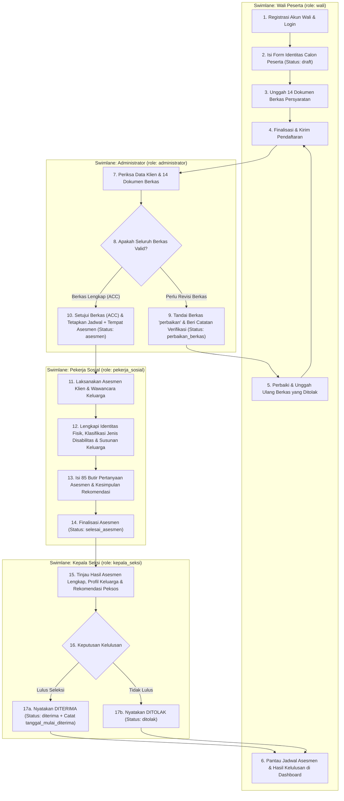
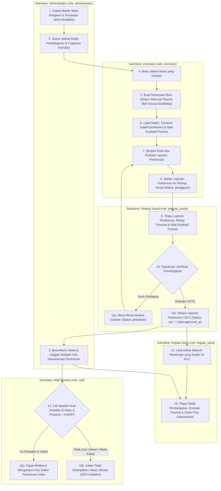
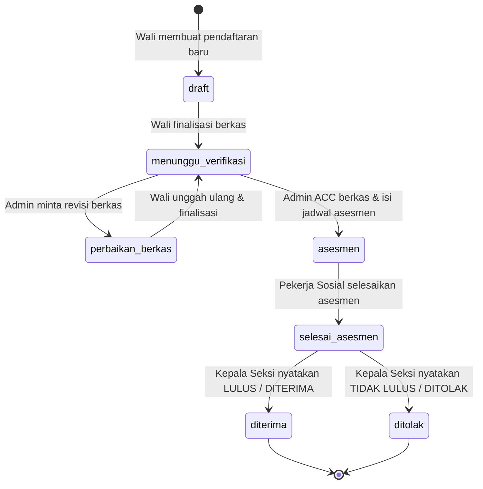
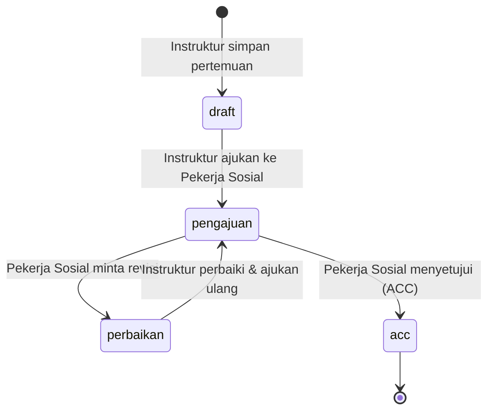

# Product Requirements Document (PRD)
## Sistem Informasi Pelayanan dan Rehabilitasi Sosial Penyandang Disabilitas (SI-PKBK)

---

## 1. Ringkasan Eksekutif & Tujuan Sistem

**SI-PKBK** adalah platform berbasis web (*Single Page Application* menggunakan **Laravel 12 + Inertia.js v3 + Svelte 5**) yang dirancang untuk mendigitalisasi seluruh siklus layanan rehabilitasi sosial penyandang disabilitas (**Tuna Netra**, **Tuna Rungu**, dan **Tuna Wicara**) secara terpadu dari hulu ke hilir.

### Tujuan Utama
1. **Digitalisasi Pendaftaran & Pemberkasan**: Memudahkan Orang Tua / Wali mendaftarkan calon penerima manfaat (klien/peserta) secara daring melalui tahapan terstruktur (*multi-step wizard*) beserta unggah dokumen persyaratan.
2. **Standarisasi Verifikasi & Asesmen**: Memfasilitasi Administrator dalam memverifikasi berkas administrasi dan menjadwalkan asesmen, serta Pekerja Sosial dalam melaksanakan asesmen komprehensif (fisik, sosial, mental-spiritual, penglihatan, riwayat kelahiran, dan perkembangan balita).
3. **Transparansi Penentuan Kelulusan**: Memberikan landasan data asesmen yang lengkap bagi Kepala Seksi untuk menetapkan kelulusan penerimaan peserta (`diterima` atau `ditolak`).
4. **Akuntabilitas Proses Pembelajaran**: Mencatat pelaksanaan pertemuan pembelajaran harian oleh Instruktur (presensi dan penilaian kualitatif peserta) yang wajib diverifikasi (**ACC** atau **Perbaikan**) oleh Pekerja Sosial.
5. **Dokumentasi & Keterbukaan Informasi bagi Wali**: Menyediakan Galeri Foto Pembelajaran yang terhubung langsung dengan pertemuan kelas, dengan kontrol akses ketat di mana Wali hanya dapat melihat dokumentasi kegiatan apabila anaknya terdaftar di kelas tersebut dan tercatat **Hadir**.

---

## 2. Spesifikasi Hak Akses per Role (RBAC & Matriks Otorisasi)

Sistem menerapkan kontrol akses berbasis peran (*Role-Based Access Control*) menggunakan paket `spatie/laravel-permission` dan *middleware* otorisasi Laravel. Berikut adalah rincian lengkap hak akses untuk masing-masing dari **5 Role**:

### 2.1 Rincian Hak Akses Tiap Role

#### A. Administrator (`role: administrator`)
- **Permissions**: `access.manage`, `wali.manage`, `pendaftaran.manage`, `mata_pelajaran.manage`, `jadwal.manage`, `galeri.manage`
- **Hak Akses & Kewenangan**:
  1. **Dashboard (`/dashboard`)**: Melihat ringkasan statistik sistem (total akun, wali, pendaftar menunggu verifikasi/perbaikan, peserta diterima, jadwal, pertemuan ACC, dan galeri) beserta daftar pendaftaran terbaru dan galeri terbaru.
  2. **User Master (`/user-master`)**: **Create, Read, Update, Delete (CRUD)** seluruh akun pengguna sistem dan menetapkan role pengguna.
  3. **Role Master (`/role-master`)**: **CRUD** role dan mengatur daftar *permission* yang melekat pada setiap role.
  4. **Wali Master (`/wali-master`)**: **Read, Update, Delete** data profil orang tua / wali peserta.
  5. **Mata Pelajaran (`/mata-pelajaran`)**: **CRUD** mata pelajaran dan memetakan relasi jenis disabilitas (`Tuna Wicara`, `Tuna Rungu`, `Tuna Netra`) untuk tiap mata pelajaran.
  6. **Jadwal Pembelajaran (`/jadwal` & `/jadwal/cetak`)**: **CRUD** jadwal kelas (tahun, hari, jam, ruangan, mata pelajaran, instruktur pengampu) serta mencetak jadwal pembelajaran.
  7. **Verifikasi Pendaftaran (`/admin/pendaftaran` & `/admin/pendaftaran/{pendaftaran}`)**: **Read & Verify** seluruh pendaftaran peserta non-draft, memeriksa tiap dokumen berkas (`diterima` / `perbaikan`), meminta revisi berkas (`perbaikan_berkas`), atau menyetujui berkas ke tahap `asesmen` sekaligus menetapkan jadwal & tempat asesmen.
  8. **Galeri Pembelajaran (`/admin/galeri` & `/admin/galeri/{galeri}`)**: **CRUD** album galeri yang terhubung ke pertemuan pembelajaran instruktur, mengunggah banyak foto sekaligus (*multiple upload*), menambah/menghapus foto individual pada galeri.
- **Batasan Akses**:
  - Tidak melakukan pengisian form asesmen klinis/sosial peserta (wewenang Pekerja Sosial).
  - Tidak menentukan kelulusan akhir peserta pasca-asesmen (wewenang Kepala Seksi).
  - Tidak menginput presensi/nilai pertemuan kelas atau meng-ACC laporan pertemuan pembelajaran.

#### B. Wali Peserta (`role: wali`)
- **Permissions**: `pendaftaran.form`
- **Hak Akses & Kewenangan**:
  1. **Registrasi Mandiri (`/register`)**: Membuat akun wali beserta identitas dasar wali.
  2. **Dashboard (`/dashboard`)**: Melihat ringkasan anak/peserta yang didaftarkan, status tahapan pendaftaran, jadwal asesmen, catatan revisi berkas, riwayat kehadiran & evaluasi belajar anak pada pertemuan yang telah di-ACC, serta pratinjau galeri kegiatan anak.
  3. **Pendaftaran Peserta (`/pendaftaran`)**:
     - **Create & Update** data pendaftaran calon peserta (anak/klien) selama berstatus `draft` (mendukung pendaftaran lebih dari 1 anak).
     - **Upload & Re-upload** 14 dokumen berkas persyaratan (dan mengunduh *template* surat `.docx`) saat status `draft` maupun saat diminta revisi (`perbaikan_berkas`).
     - **Submit / Finalize** pendaftaran untuk diverifikasi oleh Administrator (`menunggu_verifikasi`).
     - **Read** progres status pendaftaran dari tahap verifikasi, jadwal asesmen, hingga keputusan kelulusan (`diterima` / `ditolak`).
  4. **Galeri Pembelajaran (`/galeri` & `/galeri/{galeri}`)**:
     - **Read (Terbatas / Conditional Access)**: Hanya dapat melihat daftar dan detail galeri foto dari pertemuan pembelajaran di mana anak/peserta milik wali tersebut **terdaftar aktif (`status_pendaftaran = 'diterima'`)** pada jenis disabilitas kelas tersebut **DAN tercatat hadir (`presensi = 'hadir'`)** pada pertemuan itu.
- **Batasan Akses**:
  - Tidak dapat melihat data peserta milik wali lain.
  - Tidak dapat mengubah data pendaftaran yang sudah difinalisasi kecuali mengunggah ulang berkas yang berstatus `perbaikan` saat `status_pendaftaran = 'perbaikan_berkas'`.
  - Ditolak (`403 Forbidden`) melihat galeri foto pertemuan apabila anaknya berstatus `izin`, `absen`, atau tidak terdaftar di kelas tersebut.

#### C. Pekerja Sosial (`role: pekerja_sosial`)
- **Permissions**: `asesmen.do`, `pembelajaran.approve`
- **Hak Akses & Kewenangan**:
  1. **Dashboard (`/dashboard`)**: Melihat statistik antrean klien yang menunggu asesmen, asesmen selesai, pertemuan pembelajaran yang menunggu *approval*, dan pertemuan yang telah di-ACC.
  2. **Asesmen Klien (`/pekerja-sosial/asesmen` & `/pekerja-sosial/asesmen/{pendaftaran}`)**:
     - **Read** daftar peserta yang telah lolos verifikasi berkas (`status_pendaftaran` dalam `['asesmen', 'selesai_asesmen', 'diterima', 'ditolak']`).
     - **Create & Update** data asesmen komprehensif: melengkapi identitas fisik & disabilitas klien, memperbarui data sosial-ekonomi wali, mengelola tabel dinamis susunan anggota keluarga (`anggota_keluarga`), mengisi riwayat pendidikan & sikap emosional, mengisi 85 butir instrumen pertanyaan terstruktur (`asesmen_jawaban`), serta menyusun kesimpulan & rekomendasi bantuan.
     - **Finalize Asesmen**: Menyimpan asesmen sebagai `draft` atau `selesai` (yang otomatis mengubah status peserta menjadi `selesai_asesmen` agar dapat diputuskan kelulusannya oleh Kepala Seksi).
  3. **Approval Pembelajaran (`/pekerja-sosial/pembelajaran` & `/pekerja-sosial/pembelajaran/{pertemuan}`)**:
     - **Read** seluruh laporan pertemuan pembelajaran yang diajukan Instruktur (`pengajuan`, `perbaikan`, `acc`) beserta daftar presensi dan nilai kualitatif peserta.
     - **Approve / Reject (`POST /pekerja-sosial/pembelajaran/{pertemuan}`)**: Memberikan keputusan **Disetujui (`acc`)** atau **Minta Perbaikan (`perbaikan`)** disertai `catatan_pekerja_sosial`.
- **Batasan Akses**:
  - Tidak dapat memproses asesmen peserta yang masih berstatus `draft`, `menunggu_verifikasi`, atau `perbaikan_berkas`.
  - Tidak dapat memverifikasi pertemuan pembelajaran yang masih berstatus `draft` (belum diajukan oleh Instruktur).
  - Tidak dapat memutuskan kelulusan akhir penerimaan peserta (wewenang Kepala Seksi).

#### D. Instruktur (`role: instruktur`)
- **Permissions**: `pembelajaran.do`
- **Hak Akses & Kewenangan**:
  1. **Dashboard (`/dashboard`)**: Melihat ringkasan jadwal kelas yang diampu sendiri, jumlah pertemuan yang perlu tindakan (`draft` / `perbaikan`), menunggu verifikasi, dan telah di-ACC, beserta daftar kelas dan riwayat pertemuan terbaru.
  2. **Proses Pembelajaran (`/instruktur/pembelajaran` & `/instruktur/pembelajaran/jadwal/{jadwal}`)**:
     - **Read** daftar jadwal kelas yang ditugaskan khusus kepada instruktur yang sedang login (`jadwal.instruktur_id = auth()->id()`).
     - **Create & Update** pertemuan pembelajaran (`tanggal`, `keterangan` materi) beserta input **Presensi** (`hadir`, `izin`, `absen`), **Nilai Kualitatif** (`sangat_baik`, `baik`, `cukup`, `kurang`), dan **Keterangan Evaluasi** untuk setiap peserta aktif di kelas tersebut selama status pertemuan masih `draft` atau `perbaikan`.
     - **Submit / Ajukan (`POST /instruktur/pembelajaran/{pertemuan}/ajukan`)**: Mengajukan laporan pertemuan pembelajaran ke Pekerja Sosial (`status = 'pengajuan'`).
- **Batasan Akses**:
  - Ditolak (`403 Forbidden`) mengakses atau mengelola jadwal kelas milik instruktur lain.
  - Tidak dapat mengubah data pertemuan, presensi, maupun nilai peserta apabila status pertemuan sedang `pengajuan` atau sudah `acc`.
  - Tidak dapat mengakses modul pendaftaran, asesmen, kelulusan, maupun manajemen master.

#### E. Kepala Seksi (`role: kepala_seksi`)
- **Permissions**: `pendaftaran.kelulusan`
- **Hak Akses & Kewenangan**:
  1. **Dashboard (`/dashboard`)**: Melihat statistik peserta yang menunggu keputusan kelulusan, peserta diterima & ditolak, total pertemuan pembelajaran berstatus ACC, serta total album & foto galeri dokumentasi.
  2. **Penentuan Kelulusan (`/kepala-seksi/kelulusan` & `/kepala-seksi/kelulusan/{pendaftaran}`)**:
     - **Read** daftar peserta yang telah selesai asesmen (`selesai_asesmen`, `diterima`, `ditolak`) beserta seluruh rincian hasil asesmen Pekerja Sosial, profil keluarga, dan dokumen klien.
     - **Decide (`POST /kepala-seksi/kelulusan/{pendaftaran}`)**: Menetapkan keputusan akhir kelulusan peserta menjadi **Diterima (`diterima`)** (yang otomatis mencatat `tanggal_mulai_diterima`) atau **Ditolak (`ditolak`)**.
  3. **Data Pembelajaran ACC & Galeri (`/kepala-seksi/pembelajaran` & `/kepala-seksi/pembelajaran/{pertemuan}`)**:
     - **Read** seluruh pertemuan pembelajaran yang telah disetujui (**ACC**) oleh Pekerja Sosial (`status = 'acc'`).
     - **Read** detail lengkap pertemuan pembelajaran meliputi informasi jadwal & instruktur, catatan verifikasi Pekerja Sosial, tabel rekapitulasi presensi & nilai kualitatif seluruh peserta, serta seluruh album **Galeri Foto Pembelajaran** yang terhubung (dilengkapi pratinjau *lightbox* dan unduh foto).
- **Batasan Akses**:
  - Tidak dapat menetapkan kelulusan pada peserta yang belum menyelesaikan tahap asesmen (`status_pendaftaran != 'selesai_asesmen'`).
  - Ditolak (`403 Forbidden`) melihat detail pertemuan pembelajaran yang belum di-ACC oleh Pekerja Sosial (`draft`, `pengajuan`, atau `perbaikan`).
  - Bersifat *monitoring & decision maker* pada pembelajaran/galeri (tidak mengubah presensi nilai instruktur dan tidak menghapus galeri admin).

---

### 2.2 Tabel Matriks Hak Akses Lintas Modul (CRUD & Action Matrix)

Keterangan simbol:
- **C** = Create / Tambah | **R** = Read / Lihat | **U** = Update / Ubah | **D** = Delete / Hapus
- **V** = Verify / Approve | **S** = Submit / Ajukan | **P** = Print / Download
- **—** = Tidak Memiliki Akses (`403 Forbidden`)

| No | Modul / Fitur Sistem | Rute Utama | Administrator | Wali Peserta | Pekerja Sosial | Instruktur | Kepala Seksi |
| :-: | :--- | :--- | :---: | :---: | :---: | :---: | :---: |
| 1 | **Dashboard Spesifik Role** | `/dashboard` | **R** (Statistik Sistem) | **R** (Data Anak & Galeri) | **R** (Antrean Asesmen & Approval) | **R** (Jadwal & Pertemuan) | **R** (Kelulusan & Pembelajaran ACC) |
| 2 | **User Master** | `/user-master` | **C, R, U, D** | — | — | — | — |
| 3 | **Role & Permission Master** | `/role-master` | **C, R, U, D** | — | — | — | — |
| 4 | **Wali Master** | `/wali-master` | **R, U, D** | — | **U** (Saat Asesmen) | — | **R** (Saat Kelulusan) |
| 5 | **Mata Pelajaran & Disabilitas** | `/mata-pelajaran` | **C, R, U, D** | — | — | **R** (Di Jadwal) | **R** (Di Laporan) |
| 6 | **Jadwal Pembelajaran & Cetak** | `/jadwal`, `/jadwal/cetak` | **C, R, U, D, P** | — | — | **R** (Milik Sendiri) | **R** (Di Laporan) |
| 7 | **Form Pendaftaran & Upload Berkas** | `/pendaftaran` | — | **C, R, U, S** (Milik Sendiri) | — | — | — |
| 8 | **Verifikasi Berkas & Jadwal Asesmen** | `/admin/pendaftaran` | **R, U, V** (ACC / Revisi) | **R** (Status & Catatan) | — | — | — |
| 9 | **Asesmen Klien & Keluarga** | `/pekerja-sosial/asesmen` | — | — | **C, R, U, S** | — | **R** (Tinjauan Lengkap) |
| 10 | **Penentuan Kelulusan Peserta** | `/kepala-seksi/kelulusan` | — | **R** (Hasil Kelulusan) | **R** (Status Akhir) | — | **R, V** (Terima / Tolak) |
| 11 | **Input Pertemuan, Presensi & Nilai** | `/instruktur/pembelajaran` | — | **R** (Riwayat Anak di Dashboard) | **R** (Saat Approval) | **C, R, U, S** (Kelas Sendiri) | **R** (Hanya yang ACC) |
| 12 | **Approval Pertemuan Pembelajaran** | `/pekerja-sosial/pembelajaran` | — | — | **R, V** (ACC / Perbaikan) | **R** (Status & Catatan Peksos) | **R** (Info Verifikator) |
| 13 | **Manajemen Galeri Foto (Admin)** | `/admin/galeri` | **C, R, U, D** (Multiple Foto) | — | — | — | — |
| 14 | **Galeri Foto untuk Wali** | `/galeri` | — | **R, P** (Hanya Kelas di mana Anak Hadir) | — | — | — |
| 15 | **Data Pembelajaran ACC & Galeri** | `/kepala-seksi/pembelajaran` | — | — | — | — | **R, P** (Semua Pertemuan ACC & Galeri) |
| 16 | **Pengaturan Profil, Password, 2FA, Passkey** | `/settings/*` | **R, U** (Akun Sendiri) | **R, U** (Akun Sendiri) | **R, U** (Akun Sendiri) | **R, U** (Akun Sendiri) | **R, U** (Akun Sendiri) |

---

## 3. Alur Proses Bisnis dengan Swimlane per Role

### 3.1 Swimlane Flowchart 1: Alur Pendaftaran, Verifikasi Berkas, Asesmen & Kelulusan Peserta

Diagram berikut menggambarkan pembagian tanggung jawab (*swimlane*) antar-role mulai dari pendaftaran calon peserta oleh **Wali**, pemeriksaan berkas oleh **Administrator**, pelaksanaan asesmen oleh **Pekerja Sosial**, hingga penetapan kelulusan oleh **Kepala Seksi**:

---

### 3.2 Swimlane Flowchart 2: Alur Penjadwalan, Proses Pembelajaran, Approval & Galeri Dokumentasi

Diagram berikut menggambarkan pembagian tanggung jawab (*swimlane*) setelah peserta dinyatakan **Diterima (`diterima`)**, mulai dari pengaturan jadwal oleh **Administrator**, pencatatan pertemuan oleh **Instruktur**, verifikasi oleh **Pekerja Sosial**, pemantauan oleh **Kepala Seksi**, hingga akses galeri oleh **Wali**:

---

### 3.3 Siklus Status Data Utama (*State Diagrams*)

#### A. Siklus Status Pendaftaran Peserta (`pendaftaran_peserta.status_pendaftaran`)

#### B. Siklus Status Pertemuan Pembelajaran (`pertemuan_pembelajaran.status`)

---

## 4. Spesifikasi Fungsional per Modul

### 4.1 Modul Halaman Publik, Autentikasi & Keamanan Akun
- **Landing Page Publik (`/`)**: Menampilkan informasi layanan rehabilitasi sosial, persyaratan administrasi pendaftaran, dan akses menuju halaman Login/Registrasi.
- **Registrasi Wali Mandiri (`/register`)**: Pendaftaran akun pengguna baru yang secara otomatis membuat profil pada tabel `wali` (NIK, tempat/tanggal lahir, nomor HP, alamat) dan memberikan role `wali`.
- **Keamanan Akun (`/settings/*`)**:
  - Pembaruan profil dan kata sandi.
  - Autentikasi Dua Faktor (**2FA TOTP** dengan QR Code dan *recovery codes*).
  - Dukungan login tanpa kata sandi menggunakan **Passkeys (WebAuthn)**.

### 4.2 Modul Manajemen Pengguna, Role & Data Master (Administrator)
- **User Master (`/user-master`)**: CRUD akun pengguna internal maupun eksternal serta penetapan role (`administrator`, `pekerja_sosial`, `instruktur`, `kepala_seksi`, `wali`).
- **Role Master (`/role-master`)**: Pengelolaan daftar role dan pemetaan *permission* (`spatie/laravel-permission`).
- **Wali Master (`/wali-master`)**: Pemantauan, pembaruan data identitas/ekonomi wali, dan penghapusan data wali.
- **Mata Pelajaran (`/mata-pelajaran`)**:
  - CRUD mata pelajaran rehabilitasi & keterampilan.
  - Relasi *many-to-many* ke **Jenis Disabilitas** (`Tuna Wicara`, `Tuna Rungu`, `Tuna Netra`), sehingga satu mata pelajaran dapat ditujukan untuk satu atau beberapa jenis disabilitas sekaligus.
- **Jadwal Pembelajaran (`/jadwal` & `/jadwal/cetak`)**:
  - Pengaturan jadwal kelas berdasarkan Tahun, Hari (`Senin` s/d `Sabtu`), Jam Mulai & Jam Selesai, Ruangan, Keterangan, Mata Pelajaran, dan Instruktur Pengampu.
  - Fitur **Cetak Jadwal (`/jadwal/cetak`)** dalam format siap cetak (*print-friendly*).

### 4.3 Modul Pendaftaran Peserta Rehabilitasi (Wali)
Disajikan dalam bentuk **5-Step Wizard** pada rute `/pendaftaran`:
1. **Tahap 1 — Persyaratan Administrasi**: Menampilkan daftar persyaratan resmi rehabilitasi sosial.
2. **Tahap 2 — Data Klien**: Pengisian identitas calon peserta (NIK, nama lengkap, tempat & tanggal lahir dengan validasi usia **9 s/d 35 tahun**, alamat asal, pendidikan terakhir, dan keterampilan yang diminati). Sistem menghasilkan `no_pendaftaran` unik secara otomatis.
3. **Tahap 3 — Upload Dokumen Persyaratan**:
   - Mengunggah 14 jenis berkas persyaratan (sebagian wajib, sebagian opsional bila ada).
   - Mendukung pengunduhan *template* surat (`.docx`) untuk berkas pernyataan/perjanjian.
   - Jika status pendaftaran sedang `perbaikan_berkas`, Wali hanya perlu mengunggah ulang berkas yang ditandai `perbaikan` oleh Admin.
4. **Tahap 4 — Review & Finalisasi**: Tinjauan akhir seluruh data klien dan kelengkapan berkas wajib sebelum dikirim (`status_pendaftaran` berubah menjadi `menunggu_verifikasi`).
5. **Tahap 5 — Pantau Status Pendaftaran**: Menampilkan progres tahapan pendaftaran secara *real-time*, catatan verifikasi Admin, informasi jadwal & lokasi asesmen, hingga hasil keputusan kelulusan. Wali juga dapat mendaftarkan lebih dari satu peserta.

### 4.4 Modul Verifikasi Pendaftaran (Administrator)
- **Daftar & Pencarian Pendaftaran (`/admin/pendaftaran`)**: Menampilkan seluruh pendaftaran non-draft dengan pencarian berdasarkan Nomor Pendaftaran, Nama, atau NIK.
- **Pemeriksaan Tiap Berkas (`/admin/pendaftaran/{pendaftaran}`)**:
  - Admin memeriksa setiap dokumen yang diunggah Wali dan menetapkan status per berkas (`diterima`, `perbaikan`, atau `menunggu_verifikasi`) beserta keterangan perbaikan.
  - **Keputusan Revisi (`action = revisi`)**: Mengubah status pendaftaran menjadi `perbaikan_berkas` beserta `catatan_verifikasi`.
  - **Keputusan Setuju (`action = acc`)**: Mengubah status pendaftaran menjadi `asesmen` dan mewajibkan pengisian **Jadwal Asesmen (`jadwal_asesmen`)** serta **Tempat Asesmen (`tempat_asesmen`)**.

### 4.5 Modul Asesmen Klien Komprehensif (Pekerja Sosial)
Diakses melalui `/pekerja-sosial/asesmen` untuk peserta yang telah berada pada tahap `asesmen` atau setelahnya:
1. **Pembaruan Identitas Klien & Klasifikasi Disabilitas**: Melengkapi jenis kelamin, agama, status perkawinan, tinggi/berat badan, golongan darah, kondisi mata & pendengaran, penyebab & gradasi kecacatan, serta menetapkan **Jenis Disabilitas (`jenis_disabilitas_id`)** klien.
2. **Pembaruan Data Keluarga (Wali) & Susunan Anggota Keluarga**: Melengkapi pekerjaan, pangkat/golongan, penghasilan per bulan, tanggungan keluarga, status rumah, serta tabel dinamis **Susunan Anggota Keluarga (`anggota_keluarga`)**.
3. **Latar Belakang Pendidikan & Sikap Emosional**: Riwayat pendidikan formal (TK s/d PT), kursus non-formal, serta narasi sikap klien, keluarga, masyarakat, dan keluhan/hambatan.
4. **Instrumen Pertanyaan Asesmen Terstruktur (`asesmen_seksi`, `asesmen_pertanyaan`, `asesmen_jawaban`)**:
   - **Seksi 1**: Riwayat Kelahiran (20 butir pertanyaan `ya_tidak` dan `number` seperti berat `kg` & panjang `cm` lahir).
   - **Seksi 2**: Assessment Sosial (10 butir pertanyaan interaksi sosial & kemasyarakatan).
   - **Seksi 3**: Assessment Mental-Spiritual (10 butir pertanyaan ibadah, kemandirian, dan emosi).
   - **Seksi 4**: Assessment Penglihatan (20 butir pertanyaan klinis & mobilitas penglihatan).
   - **Seksi 5**: Masalah Setelah Kelahiran (riwayat bayi kuning, terapi UV, konsumsi ASI, kejang/stuip, diare, dll.).
   - **Seksi 6**: Riwayat Perkembangan Pada Masa Balita (25 butir pertanyaan perkembangan motorik & perilaku balita + *checklist* hal-hal menyolok).
5. **Maksud/Tujuan, Sumber Informasi & Kesimpulan Pekerja Sosial**: Mencakup latar belakang, pengaruh kecacatan, keinginan/harapan, dan rekomendasi bentuk bantuan.
6. **Penyimpanan Draft vs Finalisasi (`status = selesai`)**: Saat Pekerja Sosial menyimpan dengan status `selesai`, status pendaftaran klien otomatis meningkat menjadi `selesai_asesmen`.

### 4.6 Modul Penentuan Kelulusan Peserta (Kepala Seksi)
- **Daftar & Filter Kelulusan (`/kepala-seksi/kelulusan`)**: Menampilkan peserta dengan status `selesai_asesmen`, `diterima`, dan `ditolak`.
- **Tinjauan Hasil Asesmen Lengkap (`/kepala-seksi/kelulusan/{pendaftaran}`)**: Menampilkan seluruh ringkasan identitas klien, kondisi sosial-ekonomi wali, susunan keluarga, dan seluruh hasil asesmen Pekerja Sosial.
- **Keputusan Akhir (`POST /kepala-seksi/kelulusan/{pendaftaran}`)**:
  - Jika ditetapkan **Diterima (`diterima`)**: Sistem secara otomatis mengisi kolom `tanggal_mulai_diterima` (waktu mulai aktif mengikuti pembelajaran di kelas).
  - Jika ditetapkan **Ditolak (`ditolak`)**: Status peserta berubah menjadi `ditolak`.

### 4.7 Modul Proses Pembelajaran Kelas (Instruktur)
- **Daftar Kelas & Riwayat Pertemuan (`/instruktur/pembelajaran`)**: Menampilkan jadwal kelas yang diampu oleh instruktur yang sedang login.
- **Pencatatan Pertemuan & Evaluasi Peserta (`/instruktur/pembelajaran/jadwal/{jadwal}`)**:
  - Sistem secara otomatis menampilkan daftar peserta aktif (`status_pendaftaran = 'diterima'`) yang memiliki **Jenis Disabilitas** sesuai dengan mata pelajaran pada jadwal tersebut dan yang `tanggal_mulai_diterima`-nya tidak melampaui tanggal pertemuan.
  - Instruktur menginput **Tanggal Pertemuan**, **Keterangan Materi**, serta untuk setiap peserta mencatat:
    - **Presensi**: `hadir`, `izin`, atau `absen`.
    - **Nilai Kualitatif**: `sangat_baik`, `baik`, `cukup`, atau `kurang`.
    - **Keterangan Evaluasi Individu**.
  - **Pengajuan Verifikasi (`POST /instruktur/pembelajaran/{pertemuan}/ajukan`)**: Mengubah status pertemuan dari `draft` atau `perbaikan` menjadi `pengajuan` untuk diperiksa Pekerja Sosial. Pertemuan yang sudah `pengajuan` atau `acc` terkunci dari perubahan langsung oleh Instruktur.

### 4.8 Modul Verifikasi / Approval Pembelajaran (Pekerja Sosial)
- **Daftar Pengajuan Pertemuan (`/pekerja-sosial/pembelajaran`)**: Menampilkan seluruh pertemuan berstatus `pengajuan`, `perbaikan`, dan `acc`.
- **Verifikasi Detail Pertemuan (`/pekerja-sosial/pembelajaran/{pertemuan}`)**:
  - Pekerja Sosial memeriksa daftar kehadiran, nilai kualitatif peserta, dan materi pertemuan.
  - Memberikan keputusan **Perbaikan (`perbaikan`)** atau **Disetujui (`acc`)** beserta `catatan_pekerja_sosial`.
  - Saat di-ACC, sistem mencatat `pekerja_sosial_id` dan `approved_at`.

### 4.9 Modul Galeri Dokumentasi Pembelajaran & Monitoring Kepala Seksi
1. **Manajemen Galeri oleh Administrator (`/admin/galeri`)**:
   - Admin dapat membuat galeri yang terhubung ke suatu **Pertemuan Pembelajaran (`pertemuan_pembelajaran_id`)** dan mengunggah **banyak foto sekaligus (*multiple photo upload*)** dalam 1 galeri.
   - Mendukung pembaruan galeri (menambah foto baru dan/atau menandai foto lama untuk dihapus selama minimal tersisa 1 foto) serta penghapusan penuh galeri beserta file fisiknya di *storage*.
2. **Akses Galeri Terbatas untuk Wali (`/galeri` & `/galeri/{galeri}`)**:
   - Dibatasi menggunakan *query scope* `Galeri::accessibleByWali($waliId)`:
     - Wali **HANYA** dapat melihat daftar dan detail galeri apabila memiliki peserta dengan `status_pendaftaran = 'diterima'`, jenis disabilitas sesuai mata pelajaran kelas tersebut, dan pada pertemuan pembelajaran tersebut tercatat **`presensi = 'hadir'`**.
     - Wali yang anaknya tercatat `izin`, `absen`, atau tidak terdaftar di kelas tersebut tidak akan melihat galeri di daftar dan mendapatkan respons `403 Forbidden` jika mengakses URL detail secara langsung.
3. **Monitoring Pembelajaran & Galeri oleh Kepala Seksi (`/kepala-seksi/pembelajaran`)**:
   - Menampilkan seluruh pertemuan pembelajaran yang telah berstatus **ACC (`status = 'acc'`)** dari Pekerja Sosial.
   - Halaman detail (`/kepala-seksi/pembelajaran/{pertemuan}`) menyajikan informasi jadwal & instruktur, catatan verifikasi Pekerja Sosial, tabel lengkap presensi dan nilai kualitatif seluruh peserta, serta seluruh album **Galeri Foto Pembelajaran** (dilengkapi fitur *lightbox* pratinjau dan unduh foto).

### 4.10 Modul Dashboard Spesifik per Role (`/dashboard`)
Menyajikan informasi ringkas, KPI, pintasan menu, dan tabel kerja terfokus sesuai peran pengguna yang sedang login:
- **Dashboard Administrator**: Statistik antrean verifikasi berkas, peserta aktif, jadwal & mapel, galeri & akun sistem, disertai tabel pendaftaran terbaru dan galeri terbaru.
- **Dashboard Wali**: Statistik peserta terdaftar, peserta diterima, total kehadiran kelas, dan jumlah galeri tersedia, disertai kartu status tiap anak, riwayat evaluasi belajar anak, dan galeri kegiatan anak.
- **Dashboard Pekerja Sosial**: Statistik antrean asesmen klien dan antrean *approval* pertemuan pembelajaran, disertai tabel klien menunggu asesmen dan tabel pertemuan menunggu verifikasi.
- **Dashboard Instruktur**: Statistik jadwal diampu, pertemuan *draft*/perlu perbaikan, menunggu verifikasi, dan telah di-ACC, disertai daftar kelas mengajar dan riwayat pertemuan terbaru beserta catatan Pekerja Sosial.
- **Dashboard Kepala Seksi**: Statistik peserta menunggu kelulusan, peserta diterima/ditolak, pertemuan pembelajaran ACC, dan jumlah foto dokumentasi, disertai tabel penentuan kelulusan dan tabel laporan pembelajaran ACC terbaru.
