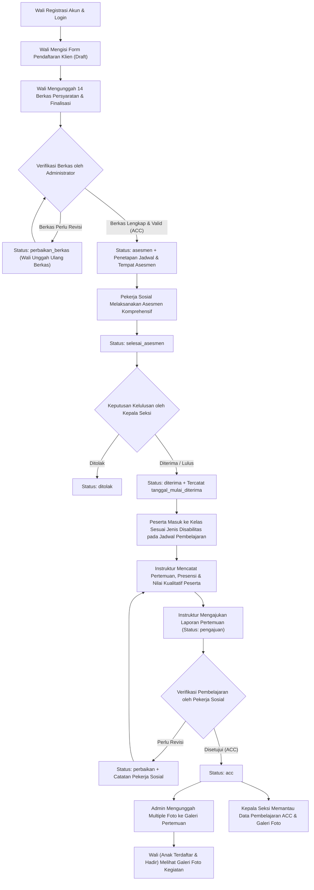
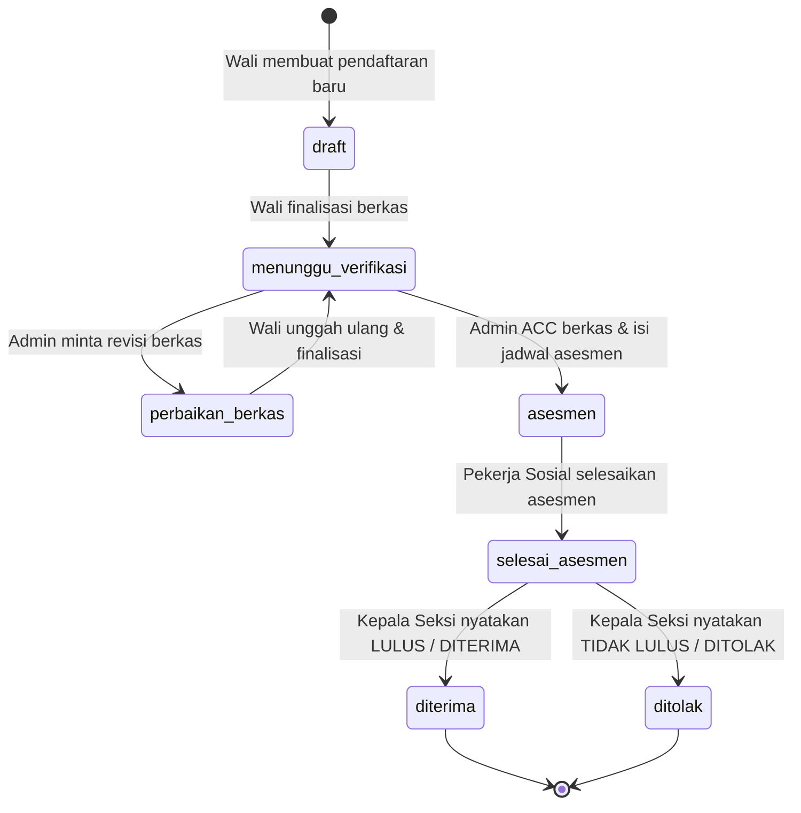
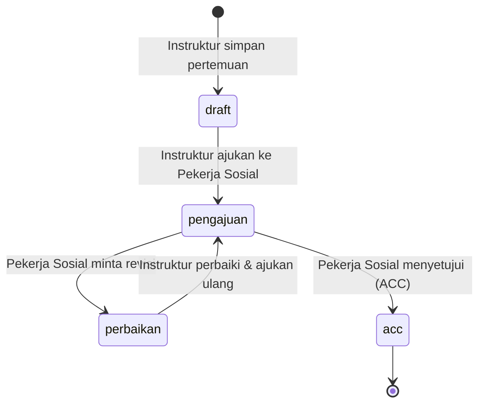

# Product Requirements Document (PRD)
## Sistem Informasi Pelayanan dan Rehabilitasi Sosial Penyandang Disabilitas (SI-PKBK)

---

## 1. Ringkasan Eksekutif & Tujuan Sistem

**SI-PKBK** adalah platform berbasis web (*Single Page Application* menggunakan **Laravel 12 + Inertia.js v3 + Svelte 5**) yang dirancang untuk mendigitalisasi seluruh siklus layanan rehabilitasi sosial penyandang disabilitas (**Tuna Netra**, **Tuna Rungu**, dan **Tuna Wicara**) secara terpadu dari hulu ke hilir.

### Tujuan Utama
1. **Digitalisasi Pendaftaran & Pemberkasan**: Memudahkan Orang Tua / Wali mendaftarkan calon penerima manfaat (klien/peserta) secara daring melalui tahapan terstruktur (*multi-step wizard*) beserta unggah dokumen persyaratan.
2. **Standarisasi Verifikasi & Asesmen**: Memfasilitasi Administrator dalam memverifikasi berkas administrasi dan menjadwalkan asesmen, serta Pekerja Sosial dalam melaksanakan asesmen komprehensif (fisik, sosial, mental-spiritual, penglihatan, riwayat kelahiran, dan perkembangan balita).
3. **Transparansi Penentuan Kelulusan**: Memberikan landasan data asesmen yang lengkap bagi Kepala Seksi untuk menetapkan kelulusan penerimaan peserta (`diterima` atau `ditolak`).
4. **Akuntabilitas Proses Pembelajaran**: Mencatat pelaksanaan pertemuan pembelajaran harian oleh Instruktur (presensi dan penilaian kualitatif peserta) yang wajib diverifikasi (**ACC** atau **Perbaikan**) oleh Pekerja Sosial.
5. **Dokumentasi & Keterbukaan Informasi bagi Wali**: Menyediakan Galeri Foto Pembelajaran yang terhubung langsung dengan pertemuan kelas, dengan kontrol akses ketat di mana Wali hanya dapat melihat dokumentasi kegiatan apabila anaknya terdaftar di kelas tersebut dan tercatat **Hadir**.

---

## 2. Aktor Pengguna & Matriks Hak Akses (RBAC)

Sistem menerapkan kontrol akses berbasis peran (*Role-Based Access Control*) menggunakan paket `spatie/laravel-permission` dengan **5 peran utama**:

| Role | kode Role | Permission (`spatie/permission`) | Tanggung Jawab Utama |
| :--- | :--- | :--- | :--- |
| **Administrator** | `administrator` | `access.manage`, `wali.manage`, `pendaftaran.manage`, `mata_pelajaran.manage`, `jadwal.manage`, `galeri.manage` | Mengelola pengguna & role, data wali, mata pelajaran, jadwal kelas, memverifikasi berkas pendaftaran peserta, menjadwalkan asesmen, serta mengelola galeri dokumentasi foto pembelajaran. |
| **Wali Peserta** | `wali` | `pendaftaran.form` | Mendaftarkan calon peserta (anak/klien), mengunggah & memperbaiki berkas persyaratan, memantau status tahapan pendaftaran, melihat rekap kehadiran/evaluasi anak, serta melihat galeri foto kegiatan pembelajaran di mana anak hadir. |
| **Pekerja Sosial** | `pekerja_sosial` | `asesmen.do`, `pembelajaran.approve` | Melaksanakan asesmen komprehensif terhadap calon peserta & keluarganya, serta memverifikasi laporan pertemuan pembelajaran yang diajukan Instruktur (`perbaikan` atau `acc`). |
| **Instruktur** | `instruktur` | `pembelajaran.do` | Mengelola pertemuan pembelajaran pada jadwal kelas yang diampu, mencatat presensi (`hadir`, `izin`, `absen`) dan nilai kualitatif peserta (`sangat_baik`, `baik`, `cukup`, `kurang`), serta mengajukan laporan pertemuan ke Pekerja Sosial. |
| **Kepala Seksi** | `kepala_seksi` | `pendaftaran.kelulusan` | Meninjau hasil asesmen Pekerja Sosial untuk memutuskan kelulusan peserta (`diterima` / `ditolak`), serta memantau seluruh laporan pertemuan pembelajaran yang telah di-ACC beserta galeri dokumentasinya. |

---

## 3. Alur Proses Bisnis End-to-End

### 3.1 Diagram Alur Proses Bisnis Utama

### 3.2 Siklus Status Pendaftaran Peserta (`status_pendaftaran`)

### 3.3 Siklus Status Pertemuan Pembelajaran (`pertemuan_pembelajaran.status`)

---

## 4. Spesifikasi Fungsional per Modul

### 4.1 Modul Halaman Publik, Autentikasi & Keamanan Akun
- **Landing Page Publik (`/`)**: Menampilkan informasi layanan rehabilitasi sosial, persyaratan administrasi pendaftaran, dan akses menuju halaman Login/Registrasi.
- **Registrasi Wali Mandiri (`/register`)**: Pendaftaran akun pengguna baru yang secara otomatis membuat profil pada tabel `wali` (NIK, tempat/tanggal lahir, nomor HP, alamat) dan memberikan role `wali`.
- **Keamanan Akun (`/settings/*`)**:
  - Pembaruan profil dan kata sandi.
  - Autentikasi Dua Faktor (**2FA TOTP** dengan QR Code dan *recovery codes*).
  - Dukungan login tanpa kata sandi menggunakan **Passkeys (WebAuthn)**.

### 4.2 Modul Manajemen Pengguna, Role & Data Master (Administrator)
- **User Master (`/user-master`)**: CRUD akun pengguna internal maupun eksternal serta penetapan role (`administrator`, `pekerja_sosial`, `instruktur`, `kepala_seksi`, `wali`).
- **Role Master (`/role-master`)**: Pengelolaan daftar role dan pemetaan *permission* (`spatie/laravel-permission`).
- **Wali Master (`/wali-master`)**: Pemantauan, pembaruan data identitas/ekonomi wali, dan penghapusan data wali.
- **Mata Pelajaran (`/mata-pelajaran`)**:
  - CRUD mata pelajaran rehabilitasi & keterampilan.
  - Relasi *many-to-many* ke **Jenis Disabilitas** (`Tuna Wicara`, `Tuna Rungu`, `Tuna Netra`), sehingga satu mata pelajaran dapat ditujukan untuk satu atau beberapa jenis disabilitas sekaligus.
- **Jadwal Pembelajaran (`/jadwal` & `/jadwal/cetak`)**:
  - Pengaturan jadwal kelas berdasarkan Tahun, Hari (`Senin` s/d `Sabtu`), Jam Mulai & Jam Selesai, Ruangan, Keterangan, Mata Pelajaran, dan Instruktur Pengampu.
  - Fitur **Cetak Jadwal (`/jadwal/cetak`)** dalam format siap cetak (*print-friendly*).

### 4.3 Modul Pendaftaran Peserta Rehabilitasi (Wali)
Disajikan dalam bentuk **5-Step Wizard** pada rute `/pendaftaran`:
1. **Tahap 1 — Persyaratan Administrasi**: Menampilkan daftar persyaratan resmi rehabilitasi sosial.
2. **Tahap 2 — Data Klien**: Pengisian identitas calon peserta (NIK, nama lengkap, tempat & tanggal lahir dengan validasi usia **9 s/d 35 tahun**, alamat asal, pendidikan terakhir, dan keterampilan yang diminati). Sistem menghasilkan `no_pendaftaran` unik secara otomatis.
3. **Tahap 3 — Upload Dokumen Persyaratan**:
   - Mengunggah 14 jenis berkas persyaratan (sebagian wajib, sebagian opsional bila ada).
   - Mendukung pengunduhan *template* surat (`.docx`) untuk berkas pernyataan/perjanjian.
   - Jika status pendaftaran sedang `perbaikan_berkas`, Wali hanya perlu mengunggah ulang berkas yang ditandai `perbaikan` oleh Admin.
4. **Tahap 4 — Review & Finalisasi**: Tinjauan akhir seluruh data klien dan kelengkapan berkas wajib sebelum dikirim (`status_pendaftaran` berubah menjadi `menunggu_verifikasi`).
5. **Tahap 5 — Pantau Status Pendaftaran**: Menampilkan progres tahapan pendaftaran secara *real-time*, catatan verifikasi Admin, informasi jadwal & lokasi asesmen, hingga hasil keputusan kelulusan. Wali juga dapat mendaftarkan lebih dari satu peserta.

### 4.4 Modul Verifikasi Pendaftaran (Administrator)
- **Daftar & Pencarian Pendaftaran (`/admin/pendaftaran`)**: Menampilkan seluruh pendaftaran non-draft dengan pencarian berdasarkan Nomor Pendaftaran, Nama, atau NIK.
- **Pemeriksaan Tiap Berkas (`/admin/pendaftaran/{pendaftaran}`)**:
  - Admin memeriksa setiap dokumen yang diunggah Wali dan menetapkan status per berkas (`diterima`, `perbaikan`, atau `menunggu_verifikasi`) beserta keterangan perbaikan.
  - **Keputusan Revisi (`action = revisi`)**: Mengubah status pendaftaran menjadi `perbaikan_berkas` beserta `catatan_verifikasi`.
  - **Keputusan Setuju (`action = acc`)**: Mengubah status pendaftaran menjadi `asesmen` dan mewajibkan pengisian **Jadwal Asesmen (`jadwal_asesmen`)** serta **Tempat Asesmen (`tempat_asesmen`)**.

### 4.5 Modul Asesmen Klien Komprehensif (Pekerja Sosial)
Diakses melalui `/pekerja-sosial/asesmen` untuk peserta yang telah berada pada tahap `asesmen` atau setelahnya:
1. **Pembaruan Identitas Klien & Klasifikasi Disabilitas**: Melengkapi jenis kelamin, agama, status perkawinan, tinggi/berat badan, golongan darah, kondisi mata & pendengaran, penyebab & gradasi kecacatan, serta menetapkan **Jenis Disabilitas (`jenis_disabilitas_id`)** klien.
2. **Pembaruan Data Keluarga (Wali) & Susunan Anggota Keluarga**: Melengkapi pekerjaan, pangkat/golongan, penghasilan per bulan, tanggungan keluarga, status rumah, serta tabel dinamis **Susunan Anggota Keluarga (`anggota_keluarga`)**.
3. **Latar Belakang Pendidikan & Sikap Emosional**: Riwayat pendidikan formal (TK s/d PT), kursus non-formal, serta narasi sikap klien, keluarga, masyarakat, dan keluhan/hambatan.
4. **Instrumen Pertanyaan Asesmen Terstruktur (`asesmen_seksi`, `asesmen_pertanyaan`, `asesmen_jawaban`)**:
   - **Seksi 1**: Riwayat Kelahiran (20 butir pertanyaan `ya_tidak` dan `number` seperti berat `kg` & panjang `cm` lahir).
   - **Seksi 2**: Assessment Sosial (10 butir pertanyaan interaksi sosial & kemasyarakatan).
   - **Seksi 3**: Assessment Mental-Spiritual (10 butir pertanyaan ibadah, kemandirian, dan emosi).
   - **Seksi 4**: Assessment Penglihatan (20 butir pertanyaan klinis & mobilitas penglihatan).
   - **Seksi 5**: Masalah Setelah Kelahiran (riwayat bayi kuning, terapi UV, konsumsi ASI, kejang/stuip, diare, dll.).
   - **Seksi 6**: Riwayat Perkembangan Pada Masa Balita (25 butir pertanyaan perkembangan motorik & perilaku balita + *checklist* hal-hal menyolok).
5. **Maksud/Tujuan, Sumber Informasi & Kesimpulan Pekerja Sosial**: Mencakup latar belakang, pengaruh kecacatan, keinginan/harapan, dan rekomendasi bentuk bantuan.
6. **Penyimpanan Draft vs Finalisasi (`status = selesai`)**: Saat Pekerja Sosial menyimpan dengan status `selesai`, status pendaftaran klien otomatis meningkat menjadi `selesai_asesmen`.

### 4.6 Modul Penentuan Kelulusan Peserta (Kepala Seksi)
- **Daftar & Filter Kelulusan (`/kepala-seksi/kelulusan`)**: Menampilkan peserta dengan status `selesai_asesmen`, `diterima`, dan `ditolak`.
- **Tinjauan Hasil Asesmen Lengkap (`/kepala-seksi/kelulusan/{pendaftaran}`)**: Menampilkan seluruh ringkasan identitas klien, kondisi sosial-ekonomi wali, susunan keluarga, dan seluruh hasil asesmen Pekerja Sosial.
- **Keputusan Akhir (`POST /kepala-seksi/kelulusan/{pendaftaran}`)**:
  - Jika ditetapkan **Diterima (`diterima`)**: Sistem secara otomatis mengisi kolom `tanggal_mulai_diterima` (waktu mulai aktif mengikuti pembelajaran di kelas).
  - Jika ditetapkan **Ditolak (`ditolak`)**: Status peserta berubah menjadi `ditolak`.

### 4.7 Modul Proses Pembelajaran Kelas (Instruktur)
- **Daftar Kelas & Riwayat Pertemuan (`/instruktur/pembelajaran`)**: Menampilkan jadwal kelas yang diampu oleh instruktur yang sedang login.
- **Pencatatan Pertemuan & Evaluasi Peserta (`/instruktur/pembelajaran/jadwal/{jadwal}`)**:
  - Sistem secara otomatis menampilkan daftar peserta aktif (`status_pendaftaran = 'diterima'`) yang memiliki **Jenis Disabilitas** sesuai dengan mata pelajaran pada jadwal tersebut dan yang `tanggal_mulai_diterima`-nya tidak melampaui tanggal pertemuan.
  - Instruktur menginput **Tanggal Pertemuan**, **Keterangan Materi**, serta untuk setiap peserta mencatat:
    - **Presensi**: `hadir`, `izin`, atau `absen`.
    - **Nilai Kualitatif**: `sangat_baik`, `baik`, `cukup`, atau `kurang`.
    - **Keterangan Evaluasi Individu**.
  - **Pengajuan Verifikasi (`POST /instruktur/pembelajaran/{pertemuan}/ajukan`)**: Mengubah status pertemuan dari `draft` atau `perbaikan` menjadi `pengajuan` untuk diperiksa Pekerja Sosial. Pertemuan yang sudah `pengajuan` atau `acc` terkunci dari perubahan langsung oleh Instruktur.

### 4.8 Modul Verifikasi / Approval Pembelajaran (Pekerja Sosial)
- **Daftar Pengajuan Pertemuan (`/pekerja-sosial/pembelajaran`)**: Menampilkan seluruh pertemuan berstatus `pengajuan`, `perbaikan`, dan `acc`.
- **Verifikasi Detail Pertemuan (`/pekerja-sosial/pembelajaran/{pertemuan}`)**:
  - Pekerja Sosial memeriksa daftar kehadiran, nilai kualitatif peserta, dan materi pertemuan.
  - Memberikan keputusan **Perbaikan (`perbaikan`)** atau **Disetujui (`acc`)** beserta `catatan_pekerja_sosial`.
  - Saat di-ACC, sistem mencatat `pekerja_sosial_id` dan `approved_at`.

### 4.9 Modul Galeri Dokumentasi Pembelajaran & Monitoring Kepala Seksi
1. **Manajemen Galeri oleh Administrator (`/admin/galeri`)**:
   - Admin dapat membuat galeri yang terhubung ke suatu **Pertemuan Pembelajaran (`pertemuan_pembelajaran_id`)** dan mengunggah **banyak foto sekaligus (*multiple photo upload*)** dalam 1 galeri.
   - Mendukung pembaruan galeri (menambah foto baru dan/atau menandai foto lama untuk dihapus selama minimal tersisa 1 foto) serta penghapusan penuh galeri beserta file fisiknya di *storage*.
2. **Akses Galeri Terbatas untuk Wali (`/galeri` & `/galeri/{galeri}`)**:
   - Dibatasi menggunakan *query scope* `Galeri::accessibleByWali($waliId)`:
     - Wali **HANYA** dapat melihat daftar dan detail galeri apabila memiliki peserta dengan `status_pendaftaran = 'diterima'`, jenis disabilitas sesuai mata pelajaran kelas tersebut, dan pada pertemuan pembelajaran tersebut tercatat **`presensi = 'hadir'`**.
     - Wali yang anaknya tercatat `izin`, `absen`, atau tidak terdaftar di kelas tersebut tidak akan melihat galeri di daftar dan mendapatkan respons `403 Forbidden` jika mengakses URL detail secara langsung.
3. **Monitoring Pembelajaran & Galeri oleh Kepala Seksi (`/kepala-seksi/pembelajaran`)**:
   - Menampilkan seluruh pertemuan pembelajaran yang telah berstatus **ACC (`status = 'acc'`)** dari Pekerja Sosial.
   - Halaman detail (`/kepala-seksi/pembelajaran/{pertemuan}`) menyajikan informasi jadwal & instruktur, catatan verifikasi Pekerja Sosial, tabel lengkap presensi dan nilai kualitatif seluruh peserta, serta seluruh album **Galeri Foto Pembelajaran** (dilengkapi fitur *lightbox* pratinjau dan unduh foto).

### 4.10 Modul Dashboard Spesifik per Role (`/dashboard`)
Menyajikan informasi ringkas, KPI, pintasan menu, dan tabel kerja terfokus sesuai peran pengguna yang sedang login:
- **Dashboard Administrator**: Statistik antrean verifikasi berkas, peserta aktif, jadwal & mapel, galeri & akun sistem, disertai tabel pendaftaran terbaru dan galeri terbaru.
- **Dashboard Wali**: Statistik peserta terdaftar, peserta diterima, total kehadiran kelas, dan jumlah galeri tersedia, disertai kartu status tiap anak, riwayat evaluasi belajar anak, dan galeri kegiatan anak.
- **Dashboard Pekerja Sosial**: Statistik antrean asesmen klien dan antrean *approval* pertemuan pembelajaran, disertai tabel klien menunggu asesmen dan tabel pertemuan menunggu verifikasi.
- **Dashboard Instruktur**: Statistik jadwal diampu, pertemuan *draft*/perlu perbaikan, menunggu verifikasi, dan telah di-ACC, disertai daftar kelas mengajar dan riwayat pertemuan terbaru beserta catatan Pekerja Sosial.
- **Dashboard Kepala Seksi**: Statistik peserta menunggu kelulusan, peserta diterima/ditolak, pertemuan pembelajaran ACC, dan jumlah foto dokumentasi, disertai tabel penentuan kelulusan dan tabel laporan pembelajaran ACC terbaru.
